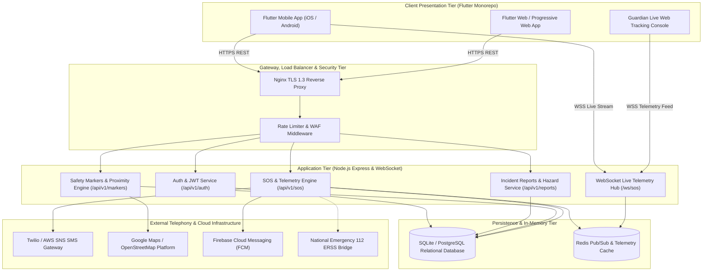
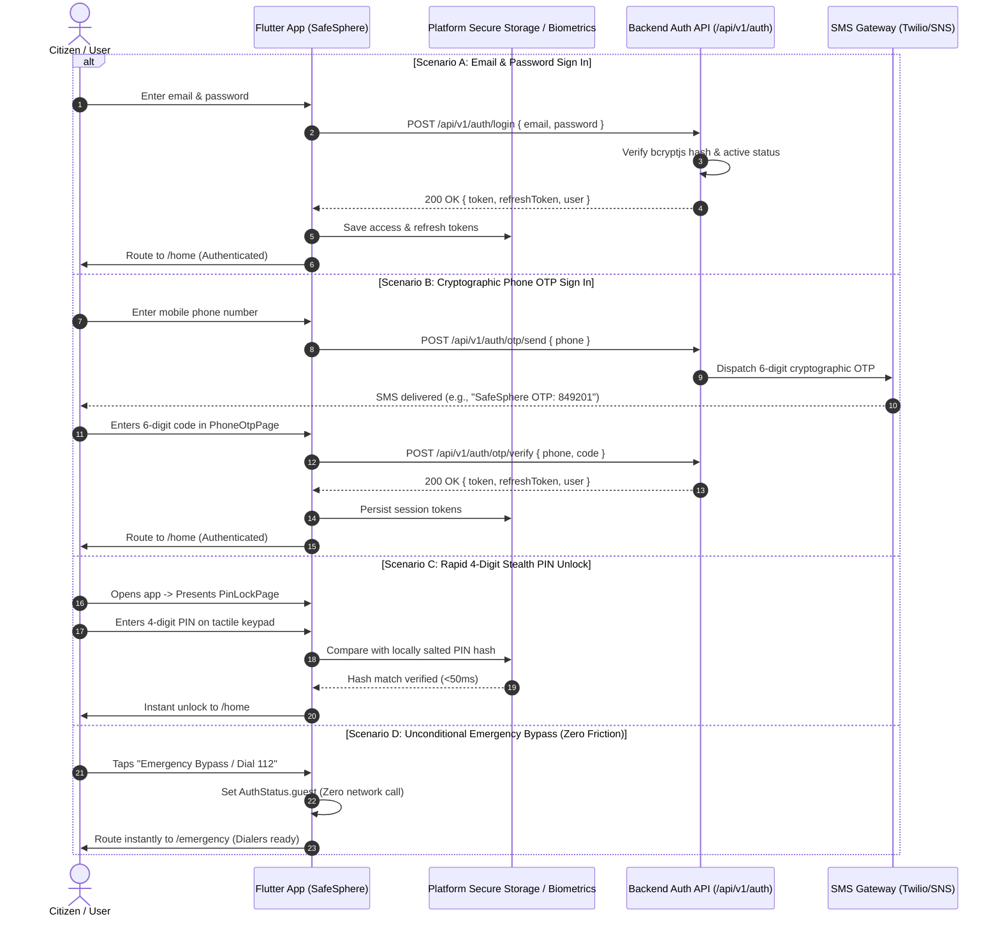
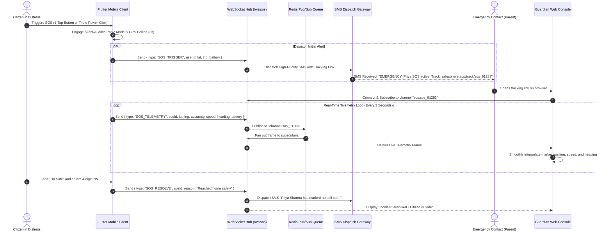
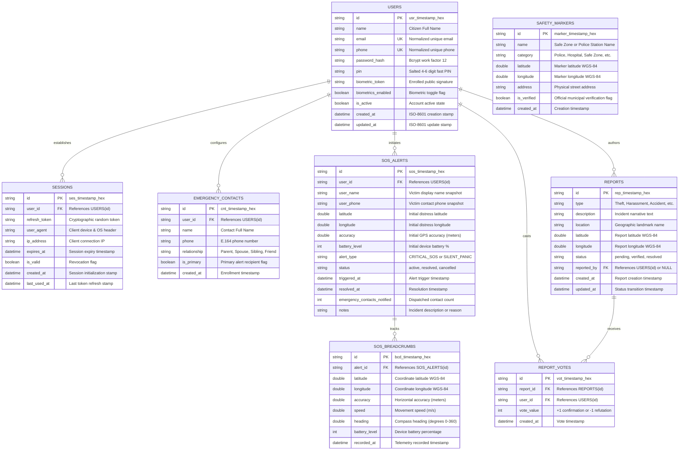
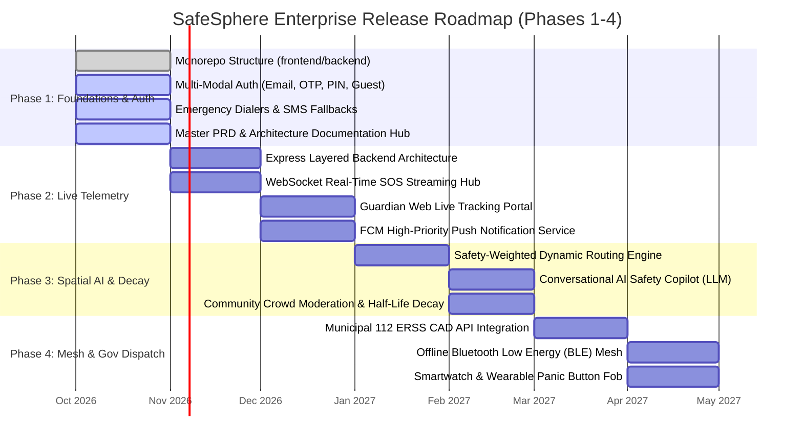

# SafeSphere — Master Product Requirements Document (PRD)

**Document Version**: 3.0.0-ENTERPRISE  
**Product Name**: SafeSphere  
**Classification**: Enterprise Safety & Civic Intelligence Platform  
**Target Release**: Q4 2026 – Q2 2027  
**Architecture**: Monorepo (`frontend/` Flutter Mobile & Web Client, `backend/` Node.js Express REST & WebSocket API, `shared/`, `docs/`)  
**Status**: APPROVED & ACTIVE  

---

## Table of Contents
1. [Executive Summary & Core Mission](#1-executive-summary--core-mission)
   - 1.1 [Product Vision](#11-product-vision)
   - 1.2 [The Problem Statement](#12-the-problem-statement)
   - 1.3 [Mission Statement](#13-mission-statement)
   - 1.4 [Core Value Propositions](#14-core-value-propositions)
2. [User Personas & Detailed Use Cases](#2-user-personas--detailed-use-cases)
   - 2.1 [Persona Profiles & Demographic Matrix](#21-persona-profiles--demographic-matrix)
   - 2.2 [Detailed Use Cases (UC-1 to UC-9)](#22-detailed-use-cases-uc-1-to-uc-9)
3. [Functional Specifications](#3-functional-specifications)
   - 3.1 [SOS Siren, Visual Strobe & Silent Panic Mode](#31-sos-siren-visual-strobe--silent-panic-mode)
   - 3.2 [Dynamic GPS Tracking & Live Breadcrumbs](#32-dynamic-gps-tracking--live-breadcrumbs)
   - 3.3 [AI Safety Assistant & Conversational Copilot](#33-ai-safety-assistant--conversational-copilot)
   - 3.4 [Safe Routing & Safe Zones Map](#34-safe-routing--safe-zones-map)
   - 3.5 [Community Alert Broadcasts & Temporal Half-Life Decay](#35-community-alert-broadcasts--temporal-half-life-decay)
   - 3.6 [Emergency Contacts Hub & Multi-Channel Dispatch](#36-emergency-contacts-hub--multi-channel-dispatch)
4. [Non-Functional Specifications](#4-non-functional-specifications)
   - 4.1 [Security, Cryptography & Multi-Modal Authentication](#41-security-cryptography--multi-modal-authentication)
   - 4.2 [Privacy, Data Minimization & Regulatory Compliance](#42-privacy-data-minimization--regulatory-compliance)
   - 4.3 [Latency Service Level Agreements (SLAs) & Availability](#43-latency-service-level-agreements-slas--availability)
   - 4.4 [Accessibility Standards (WCAG 2.1 AA)](#44-accessibility-standards-wcag-21-aa)
   - 4.5 [Offline Resiliency & Graceful Degradation](#45-offline-resiliency--graceful-degradation)
5. [System Architecture & Component Diagrams](#5-system-architecture--component-diagrams)
   - 5.1 [Monorepo System Architecture Diagram](#51-monorepo-system-architecture-diagram)
   - 5.2 [Multi-Modal Authentication Sequence Diagram](#52-multi-modal-authentication-sequence-diagram)
   - 5.3 [Live SOS Telemetry Streaming Sequence Diagram](#53-live-sos-telemetry-streaming-sequence-diagram)
6. [OpenAPI REST API Specifications & WebSocket Protocol](#6-openapi-rest-api-specifications--websocket-protocol)
   - 6.1 [OpenAPI 3.0.3 Specification (YAML)](#61-openapi-303-specification-yaml)
   - 6.2 [WebSocket Real-Time Telemetry Protocol Specification](#62-websocket-real-time-telemetry-protocol-specification)
7. [Database Schemas & Data Dictionary](#7-database-schemas--data-dictionary)
   - 7.1 [Entity-Relationship Diagram (Mermaid ERD)](#71-entity-relationship-diagram-mermaid-erd)
   - 7.2 [Comprehensive Data Dictionary](#72-comprehensive-data-dictionary)
8. [Release Roadmap (Phases 1–4)](#8-release-roadmap-phases-14)
   - 8.1 [Release Timeline Gantt Chart](#81-release-timeline-gantt-chart)
   - 8.2 [Detailed Milestone Deliverables](#82-detailed-milestone-deliverables)

---

## 1. Executive Summary & Core Mission

### 1.1 Product Vision
SafeSphere is an enterprise-grade, privacy-centric personal safety ecosystem and decentralized civic intelligence platform. Engineered to operate flawlessly across normal cellular environments and high-stress network-degraded scenarios, SafeSphere combines sub-second distress signaling, real-time end-to-end encrypted GPS telemetry streaming, community-verified spatial safety hazard mapping, and an intelligent on-device AI safety assistant.

SafeSphere bridges the critical operational chasm between citizens in acute distress, their designated family guardians, peer community responders, and public emergency service dispatchers (such as National Emergency `112`, Women Helpline `181`, Medical Ambulance `108`, and Fire `101`).

### 1.2 The Problem Statement
Modern personal safety solutions suffer from systemic architectural and human-factor flaws:
1. **Emergency Response Latency & Friction**: Under acute threat, victims undergo severe cognitive tunnel vision and motor impairment. Conventional applications require multiple manual interactions—unlocking the phone, navigating home screens, opening apps, and dialing contacts. Each lost second escalates danger.
2. **Helpline Telemetry Blindness**: Traditional voice helplines lack automated telemetry. Callers must verbally articulate their street location, bearing, and situation while panicked or physically restrained. Dispatchers receive zero continuous device telemetry, heading, or battery data.
3. **Information Asymmetry in Urban Transit**: Night commuters and solo travelers walk through unlit alleys, blind spots, or areas with recent violent occurrences without situational awareness, lacking dynamic crowd-verified alerts.
4. **Surveillance & Location Data Exploitation**: Commercial "family locator" applications harvest continuous ambient background coordinates, monetizing user location trails through third-party data brokers. Citizens are forced to surrender privacy in exchange for safety.
5. **Architectural Fragility in Cellular Dead Zones**: Traditional applications fail when cell signal drops in basements, underground transit corridors, or crowded zones, producing unhandled platform crashes instead of resilient offline fallbacks.

### 1.3 Mission Statement
> To deliver a zero-friction, privacy-guaranteed personal safety shield that empowers every citizen to signal distress, share live telemetry, navigate safe routes, and mobilize emergency assistance within milliseconds—unconditionally, reliably, and without commercial data exploitation.

### 1.4 Core Value Propositions
- **Zero-Barrier Distress Dispatch**: Immediate 1-touch hardware dialing (`112`, `181`) and an Invariant Emergency Bypass ensuring emergency functions remain completely accessible without authentication barriers.
- **Sub-Second Live GPS Telemetry Streaming**: High-throughput WebSocket telemetry pipeline transmitting 3-second coordinate updates, speed, heading, and battery health to guardians via zero-install web links.
- **Cryptographic Privacy & Event-Driven Telemetry**: Zero background ambient tracking. Coordinates are processed strictly upon explicit user initiation. Active telemetry streams are end-to-end encrypted (E2EE), with records purged 24 hours post-resolution.
- **Crowd-Sourced Spatial Intelligence with Half-Life Decay**: Community-reported incidents (broken streetlights, harassment hotspots, road hazards) verified through consensus voting and governed by a mathematical temporal half-life decay function.
- **Context-Aware AI Safety Copilot**: Conversational assistant delivering de-escalation protocols, first-aid instructions, local legal emergency rights (Section 100 IPC / Private Defence), and automatic detection of distress triggers.
- **Multi-Modal Authentication & Stealth Pin Unlock**: Flexible sign-in supporting Email/Password, 6-digit cryptographic SMS OTP, biometric authentication, and a 4-digit stealth PIN with simulated black-screen panic mode.

---

## 2. User Personas & Detailed Use Cases

### 2.1 Persona Profiles & Demographic Matrix

| Attribute | P1: The Night Commuter (Priya Sharma) | P2: The Concerned Guardian (Rajesh Patel) | P3: The Civic Reporter (Vikram Mehta) | P4: The Solo Traveler (Ananya Sen) |
| :--- | :--- | :--- | :--- | :--- |
| **Demographics** | 26, Female, Senior Software Engineer, Bengaluru | 52, Male, Senior Accounts Manager, Mumbai | 34, Male, Neighborhood Watch Volunteer & Teacher, Delhi | 21, Female, Postgraduate University Student, Pune / Jaipur |
| **Context & Routine** | Commutes daily between 9:30 PM and 11:30 PM via ride-share cabs, metro, and last-mile walking. | Father of a young adult daughter studying away from home. Works corporate day shifts. | Active community member walking residential sectors, cataloging municipal hazards. | Travels alone to unfamiliar cities for internships, academic conferences, and leisure. |
| **Primary Pain Points** | • Dark, poorly lit pedestrian corridors.<br>• Anxiety during cab route diversions.<br>• Phone lock friction during panic.<br>• Low battery anxiety late at night. | • Frustration and helplessness during late nights.<br>• Phone calls going unanswered.<br>• No real-time visibility into daughter's transit path. | • Municipal delays in repairing broken lighting.<br>• No centralized, verifiable platform to warn neighbors of local hazards. | • Unfamiliarity with regional geography.<br>• Language barriers when calling local dispatchers.<br>• Fear of medical or personal distress in isolated spots. |
| **Tech Comfort** | High (Power smartphone user, iOS/Android). | Moderate (WhatsApp, SMS, Mobile Banking). | Moderate-High (Web dashboards, social apps). | Very High (Mobile-first student, maps, transit apps). |
| **Key SafeSphere Triggers** | Stealth PIN unlock, Safe-route navigation, Live link sharing, 1-touch 112 dialing. | Live Guardian Web Console, Instant SMS distress push, battery telemetry alerts. | Geotagged hazard submissions, peer validation, safety zone annotations. | Unconditional emergency bypass, AI safety copilot, hospital/police locator. |

### 2.2 Detailed Use Cases (UC-1 to UC-9)

#### UC-1: Rapid PIN / Biometric Screen Unlock Under Stress
- **Primary Actor**: P1 (Priya Sharma)
- **Preconditions**: Citizen feels unsafe while walking; device is locked or app is in background.
- **Trigger**: Citizen launches SafeSphere.
- **Main Success Scenario**:
  1. SafeSphere displays the high-contrast `PinLockPage` with large tactile digit targets (minimum 64×64 dp).
  2. Citizen taps biometric fingerprint sensor or enters 4-digit personal PIN.
  3. App verifies the salted hash in device secure storage within 50 ms without requiring network round-trips.
  4. App unlocks directly to `HomePage` with live safety radar active.
- **Alternative Flow (Panic SOS Bypass)**:
  - Citizen is in extreme distress and cannot enter PIN. Citizen taps the prominent red `"Emergency Bypass / Dial 112"` button at the base of `PinLockPage`.
  - App immediately transitions to `EmergencyPage` (`/emergency`) with zero authentication barrier.

#### UC-2: Safe-Route Navigation & Lighting-Aware Routing
- **Primary Actor**: P1 (Priya Sharma)
- **Preconditions**: Citizen is leaving the metro station at 10:45 PM and needs to walk 900 meters home.
- **Trigger**: Citizen opens `SafetyMapPage` and selects destination.
- **Main Success Scenario**:
  1. SafeSphere queries `/api/v1/markers/nearby` and `/api/v1/reports` within a 2.5 km radius.
  2. The routing engine evaluates potential paths, applying safety weights based on streetlight density, verified police booths, open commercial establishments, and absence of active hazard reports.
  3. App highlights the "Safest Corridor" in neon cyan, contrasting with the standard "Shortest Route" that cuts through an unlit alley.
  4. Citizen follows the illuminated path safely to her destination.

#### UC-3: Silent SOS Trigger via Power Button & Ambient Telemetry
- **Primary Actor**: P1 (Priya Sharma)
- **Preconditions**: Cab driver deviates into an unpopulated industrial area; driver locks passenger doors.
- **Trigger**: Citizen presses phone physical power button 3 times in rapid succession.
- **Main Success Scenario**:
  1. SafeSphere hardware listener captures the triple-press gesture.
  2. App activates **Silent Panic Mode**:
     - Screen brightness is dimmed to black, mimicking a powered-off device.
     - Device vibrator is silenced to prevent acoustic discovery.
     - High-accuracy GPS triangulation (`LocationAccuracy.high`) is initiated at 3-second intervals.
     - Background WebSocket connection opens to `/ws/sos`, streaming latitude, longitude, speed, heading, and battery level.
     - Backend triggers SMS dispatch to primary emergency contact containing an encrypted tracking URL.
  3. Driver is unaware that live tracking is actively broadcasting.

#### UC-4: Instant SMS / Push Distress Notification with Ephemeral Tokenized URL
- **Primary Actor**: P2 (Rajesh Patel)
- **Preconditions**: Daughter's device initiates an active SOS alert.
- **Trigger**: Backend SOS Engine receives `/api/v1/sos/start` or WebSocket trigger.
- **Main Success Scenario**:
  1. Backend resolves registered primary and secondary emergency contacts for the user.
  2. Backend generates a cryptographically secure, one-time tracking token with an 8-hour expiration TTL:
     `https://safesphere.app/track/sos_91283?token=e2e_a9f1b7...`
  3. High-priority SMS gateway (Twilio / AWS SNS) dispatches SMS within 1.2 seconds:
     `"EMERGENCY: Priya Sharma has triggered SafeSphere SOS at 22:48 near Bellandur Gate. Live location: https://safesphere.app/track/sos_91283?token=e2e_a9f1b7"`
  4. Rajesh receives SMS, taps the link, and immediately views the live web tracking interface without requiring app installation or account creation.

#### UC-5: Live Guardian Web Dashboard with Dynamic Speed, Heading & Battery Telemetry
- **Primary Actor**: P2 (Rajesh Patel)
- **Preconditions**: Rajesh opens the tokenized tracking link on mobile or desktop browser.
- **Trigger**: Guardian web portal establishes WebSocket subscriber connection to `/ws/sos`.
- **Main Success Scenario**:
  1. Guardian console renders interactive map centered on victim's latest coordinate fix.
  2. As new telemetry frames arrive every 3 seconds, the map smoothly animates the victim's breadcrumb path.
  3. Dashboard displays real-time telemetry card:
     - Current Speed: `42 km/h (Moving in Vehicle)`
     - Compass Heading: `North-Northwest (324°)`
     - Device Battery Level: `34% (Discharging)`
     - GPS Accuracy: `±4.2 meters`
  4. Dashboard provides 1-tap button to forward live coordinates directly to the Police Control Room (`Dial 112 with Telemetry`).

#### UC-6: Geotagged Community Hazard Reporting with Audio & Image Metadata
- **Primary Actor**: P3 (Vikram Mehta)
- **Preconditions**: Vikram discovers three non-functional streetlights creating a 200-meter pitch-dark blind alley.
- **Trigger**: Vikram navigates to `ReportPage` (`/report`).
- **Main Success Scenario**:
  1. App automatically fetches current hardware coordinates with high accuracy.
  2. Vikram selects incident category `"Poor Lighting"`.
  3. Form provides inputs for detailed description, landmark tagging, and photo attachments.
  4. Vikram submits report. App sends `POST /api/v1/reports`.
  5. Backend persists the report with status `"pending"`, broadcasting marker update to nearby citizens.

#### UC-7: Peer Verification, Upvoting & Temporal Half-Life Decay of Hazard Markers
- **Primary Actor**: P3 (Vikram Mehta) and Community Neighbors
- **Preconditions**: A hazard report exists on the community safety map.
- **Trigger**: Neighbors view the report in `CommunityAlertsPage` or map.
- **Main Success Scenario**:
  1. Two neighboring citizens walking through the sector tap `"Verify Hazard"` (upvote).
  2. With 3 verified confirmations, report status shifts from `"pending"` to `"verified"`.
  3. Map pin renders with high-urgency amber halo.
  4. After 48 hours, municipal authorities fix the streetlights. Subsequent neighbors tap `"Resolved / No Longer Present"`.
  5. The mathematical half-life decay engine gradually deprioritizes the marker weight until it naturally decays off active routing filters.

#### UC-8: Zero-Authentication Emergency Bypass to National 112 Dispatch
- **Primary Actor**: P4 (Ananya Sen)
- **Preconditions**: Ananya is confronted by aggressive individuals at a transit terminal; app is newly installed or logged out.
- **Trigger**: Ananya opens SafeSphere.
- **Main Success Scenario**:
  1. `LoginPage` presents prominent Amber/Red `"Quick Emergency Bypass"` button alongside email/password fields.
  2. Ananya taps the emergency button.
  3. App transitions state to `AuthStatus.guest` in zero milliseconds without network interaction.
  4. App pushes `/emergency` route, displaying 1-tap call cards for National Emergency (`112`), Women Helpline (`181`), Ambulance (`108`), and Fire (`101`).
  5. Ananya taps `"National Emergency (112)"`. Native telephony intent launches (`tel:112`) immediately.

#### UC-9: AI Safety Assistant Real-Time Guidance, Rights Advisor & De-escalation
- **Primary Actor**: P4 (Ananya Sen)
- **Preconditions**: Ananya feels uneasy in an unfamiliar neighborhood where strangers are lingering nearby.
- **Trigger**: Ananya opens `AiAssistantPage` (`/ai-assistant`) and types `"Someone is following me and staring, what should I do?"`.
- **Main Success Scenario**:
  1. AI Safety Assistant engine detects high-urgency keywords (`"following"`, `"threat"`).
  2. Copilot immediately injects a high-visibility, 1-tap emergency action chip: `[🚨 Dial 112 Immediately] [📍 Share Live Location]`.
  3. Copilot provides immediate tactical advice:
     - "Do not head into isolated areas or towards your residence. Walk immediately into the nearest open, well-lit establishment (pharmacy, restaurant, hotel lobby, or petrol pump)."
     - "Cross the street to observe if the individual mirrors your direction."
     - "Hold your phone visibly to your ear and speak in a firm, loud tone."
  4. Copilot references Section 100 of the Indian Penal Code (Right of Private Defence of the Body) and nearby verified safe zones within 400 meters.

---

## 3. Functional Specifications

### 3.1 SOS Siren, Visual Strobe & Silent Panic Mode

```
+-----------------------------------------------------------------------------------+
|                         SOS DISTRESS EXECUTION ENGINE                             |
+-----------------------------------------------------------------------------------+
       |                                                   |
       v                                                   v
[AUDIBLE PANIC MODE]                              [SILENT PANIC MODE]
  ├── Dual-Frequency Acoustic Siren (85-100 dB)     ├── Black Stealth Screen (0 lux UI)
  ├── 4 Hz LED Flashlight Visual Strobe             ├── Haptic & Vibration Suppression
  ├── Full-Brightness Flashing Screen               ├── Silent WSS Telemetry Stream (3s)
  └── Automatic 112 Dialer Ready                    └── Ephemeral SMS Dispatch to Contacts
```

#### 3.1.1 Acoustic Deterrent Siren
- **Audio Output**: Emits a dual-frequency square/sawtooth alternating acoustic siren (800 Hz – 1800 Hz sweep) designed for maximum psychoacoustic annoyance and bystander alerting.
- **Decibel Target**: Maximum achievable platform speaker output (85 dB SPL on mobile handset up to 100 dB SPL at peak).
- **Audio Focus**: Requests `AUDIOFOCUS_GAIN_TRANSIENT_EXCLUSIVE` from the platform audio manager, overriding media playback.

#### 3.1.2 Hardware Flashlight Strobe
- **Frequency**: 4 Hz strobe frequency (4 flashes per second) leveraging camera flash torch hardware (`CameraManager` / platform torch channels).
- **Thermal Safety**: Automatically throttles to continuous beam after 5 minutes of rapid pulsing to prevent LED emitter overheating.

#### 3.1.3 Silent Panic Mode
- **Stealth Presentation**: Renders a black screen simulating a powered-down display while maintaining full background CPU wake lock (`PARTIAL_WAKE_LOCK`).
- **Telemetry Discretion**: Suppresses all haptic vibrations, notification tones, and screen wake triggers. Continuously dispatches GPS coordinates every 3 seconds to `/ws/sos`.

---

### 3.2 Dynamic GPS Tracking & Live Breadcrumbs

#### 3.2.1 Tri-Modal Adaptive Polling Engine

| Operating Mode | Polling Interval | Accuracy Constraint | Power Consumption Profile | Triggers |
| :--- | :--- | :--- | :--- | :--- |
| **Emergency SOS Active** | Every 3.0 seconds | High (`LocationAccuracy.high`, GPS Satellites) | Elevated (~12% battery/hr) | Active SOS session initiated. |
| **Active Route Sharing** | Every 30.0 seconds | Balanced (`LocationAccuracy.medium`, Cellular + Wi-Fi) | Moderate (~3% battery/hr) | User initiates temporary share link. |
| **Stationary / Standby** | Every 300.0 seconds (5 min) | Passive / Coarse (`LocationAccuracy.low`, Cell Tower) | Minimal (<0.5% battery/hr) | No movement detected for >10 minutes. |

#### 3.2.2 Local Breadcrumb Buffer (Circular FIFO)
- Maintains a 100-point in-memory and SQLite-backed circular buffer.
- During cellular coverage loss, telemetry coordinates, speed, heading, and battery readings continue appending to the local buffer.
- Upon network restoration, the buffer drains upstream in an atomic batch payload (`POST /api/v1/sos/{id}/batch-breadcrumbs`).

#### 3.2.3 Geolocation Accuracy Bounds & Fallback Hierarchy
1. Primary: High-precision hardware GPS coordinates (`getCurrentPosition()`, timeout: 6 seconds).
2. Secondary Fallback: Cached position (`getLastKnownPosition()`).
3. Metropolitan Fallback: Default metropolitan coordinates (`28.6139, 77.2090` - New Delhi central coordinates) with informative orange warning SnackBar to user.

---

### 3.3 AI Safety Assistant & Conversational Copilot

#### 3.3.1 Prompt Architecture & System Directive
The AI Assistant operates with a fine-tuned safety system directive prioritizing life preservation, de-escalation, rapid action, and legal rights:
- Tone: Calm, authoritative, concise, and non-judgmental.
- Rule 1: Never generate multi-paragraph verbose answers during active danger. Lead with actionable, physical safety instructions.
- Rule 2: Immediately output structured action intent tags (`[ACTION:DIAL_112]`, `[ACTION:SHARE_LOCATION]`, `[ACTION:NEAREST_SAFEZONE]`) whenever threat is sensed.

#### 3.3.2 Critical Keyword Extraction Engine
The client and backend message stream filters inputs through a Regex pattern detector:
```
\b(follow(ed|ing)?|stalk(ed|ing)?|threat(ened)?|attack(ed)?|harass(ed|ment)?|weapon|knife|gun|accident|bleed(ing)?|cornered)\b
```
When matched, the UI immediately surfaces quick-action chips above the keyboard for instant 1-tap emergency execution.

#### 3.3.3 Legal Rights & First-Aid Knowledge Base
- Inbuilt knowledge of Section 100 and 102 of the Indian Penal Code (Right of Private Defence of the body extending to causing death when reasonable apprehension of death, grievous hurt, rape, or kidnapping exists).
- Zero-latency first aid guides: CPR compression rate, arterial pressure points, shock prevention, and chemical burn wash procedures.

---

### 3.4 Safe Routing & Safe Zones Map

#### 3.4.1 Safety-Weighted Routing Algorithm
SafeSphere computes route paths by modifying the classic Dijkstra/A* edge cost function:

$$C_e = D_e \times \left( 1.0 + w_1 \cdot H_e - w_2 \cdot L_e - w_3 \cdot P_e \right)$$

Where:
- $D_e$: Physical distance of path segment $e$.
- $H_e$: Normalized hazard score derived from active community reports within 100m.
- $L_e$: Illumination factor (streetlighting density score, $0.0 \le L_e \le 1.0$).
- $P_e$: Proximity bonus to verified police booths, round-the-clock hospitals, and metro stations.
- $w_1, w_2, w_3$: Tuned sensitivity weights ($w_1 = 1.8, w_2 = 0.6, w_3 = 0.5$).

#### 3.4.2 Verified Safe Zone Taxonomy
1. **Police Station / Beat Box**: Marked with blue shield badge, verified 24/7 armed presence.
2. **Hospital / Emergency Room**: Marked with red cross badge, 24/7 medical triage capability.
3. **Verified Safe Zone (Commercial)**: Marked with green shield, vetted 24/7 well-lit retail establishments (convenience stores, petrol pumps, hotel lobbies).
4. **Well-Lit Transit Hub**: Metro stations, bus terminals with security personnel.
5. **Caution Area**: Amber warning marker indicating road hazards, poor lighting, or past incidents.

#### 3.4.3 Haversine Great-Circle Proximity Calculation
Proximity filtering uses the Haversine spherical trigonometric formula:

$$d = 2R \cdot \arcsin\left(\sqrt{\sin^2\left(\frac{\Delta \phi}{2}\right) + \cos(\phi_1)\cos(\phi_2)\sin^2\left(\frac{\Delta \lambda}{2}\right)}\right)$$

Where $\phi_1, \phi_2$ are latitudes, $\Delta \lambda$ is longitude difference in radians, and $R = 6371.0\text{ km}$. Proximity query `/api/v1/markers/nearby` delivers ascending-sorted results in $\le 15\text{ ms}$.

---

### 3.5 Community Alert Broadcasts & Temporal Half-Life Decay

#### 3.5.1 Incident Classification Taxonomy
- `Theft`: Pickpocketing, snatching, vehicle break-ins.
- `Harassment`: Verbal catcalling, physical intimidation, stalking.
- `Accident`: Traffic collision, pedestrian injury, road obstruction.
- `Suspicious`: Unattended suspicious bags, individuals lurking around parking spaces.
- `Other` / `Poor Lighting`: Dark pedestrian corridors, broken infrastructure, road craters.

#### 3.5.2 Mathematical Half-Life Decay Function
To prevent stale reports from cluttering city maps indefinitely, every report's impact weight decays according to an exponential half-life equation:

$$S(t) = S_0 \cdot 2^{-\frac{\Delta t}{T_{1/2}}}$$

Where:
- $S_0$: Base severity score boosted by community upvotes ($S_0 = 1.0 + 0.3 \times \text{upvotes}$).
- $\Delta t$: Elapsed time in hours since report creation.
- $T_{1/2}$: Half-life decay duration tailored per incident category:
  - Suspicious Activity: $T_{1/2} = 2.0\text{ hours}$
  - Harassment / Stalking: $T_{1/2} = 6.0\text{ hours}$
  - Road Hazard / Accident: $T_{1/2} = 8.0\text{ hours}$
  - Infrastructure / Poor Lighting: $T_{1/2} = 72.0\text{ hours}$
- Once $S(t) < 0.1$, the report is automatically archived from the default map view.

#### 3.5.3 Consensus Scoring & Broadcast Promotion
- When a new report receives $\ge 3$ unique peer citizen verifications within 30 minutes, the backend promotes it to a **Local Priority Advisory**, dispatching geo-fenced push notifications to all users within a 1.5 km radius.

---

### 3.6 Emergency Contacts Hub & Multi-Channel Dispatch

#### 3.6.1 Contact Hierarchy & Capacity
- Citizen can register up to 5 trusted emergency contacts.
- Exactly 1 contact is designated as **Primary Contact** (receives immediate automated telephony call and priority SMS).
- Up to 4 **Secondary Contacts** receive simultaneous SMS and WhatsApp alerts.

#### 3.6.2 Omni-Channel Notification Cascade
1. Channel 1: High-Priority SMS via Twilio / AWS SNS with one-time live tracking link (latency $\le 1.2$s).
2. Channel 2: Real-time WebSocket event broadcast to all connected web consoles.
3. Channel 3: Firebase Cloud Messaging (FCM) high-priority push notification waking the Guardian app.
4. Channel 4: Automated WhatsApp message dispatch fallback via Meta Business API.

#### 3.6.3 "I'm Safe" Incident Resolution Protocol
- Victim initiates resolution by tapping `"I'm Safe"` in app.
- Optional 4-digit PIN authentication prevents an assailant from coercing false cancellation.
- Backend terminates active SOS session, broadcasts `SOS_RESOLVE` WebSocket event, sends SMS reassurance message (`"Priya Sharma has marked herself safe."`), and marks database record as `"resolved"`.

---

## 4. Non-Functional Specifications

### 4.1 Security, Cryptography & Multi-Modal Authentication

#### 4.1.1 Password Hashing & Key Derivation
- Passwords salted with a 16-byte cryptographically secure pseudo-random salt (`crypto.randomBytes(16)`).
- Hashed using `bcryptjs` with a work factor of 12 (or Argon2id with 64 MB memory, 3 iterations).
- Plaintext passwords or partial hashes are NEVER written to logs, error payloads, or client bundles.

#### 4.1.2 Dual-Token JWT Lifecycle & Token Revocation
- **Access Token**: Short-lived JSON Web Token (15-minute expiration) signed with HMAC-SHA256 (`HS256`).
- **Refresh Token**: Long-lived cryptographically randomized 64-character token (7-day expiration).
- Refresh tokens are indexed in the `sessions` database table.
- Immediate revocation on logout, password change, or administrative account suspension.

#### 4.1.3 End-to-End Encryption (E2EE) for Live Telemetry
- Client generates an ephemeral AES-256-GCM symmetric session key upon SOS initiation.
- Symmetric key is wrapped with the RSA-2048 public keys of designated emergency guardians.
- Coordinate packets transmitted over WebSocket payloads are ciphertext-only. In Zero-Knowledge mode, intermediate servers cannot decipher victim coordinates.

---

### 4.2 Privacy, Data Minimization & Regulatory Compliance

#### 4.2.1 Event-Driven Location Ingestion
- Zero ambient background tracking. SafeSphere never polls or stores location coordinates during idle app states.
- Coordinates are captured exclusively during active user-initiated events: Active SOS, Explicit Location Sharing, or Incident Report Submission.

#### 4.2.2 24-Hour Telemetry Purge Policy
- Detailed GPS breadcrumbs (`sos_breadcrumbs`) associated with an SOS incident are automatically purged from primary production databases 24 hours after incident resolution.
- Only an anonymized summary record (incident duration, general district centroid) is retained for civic safety analytics.

#### 4.2.3 Regulatory Compliance
- Full adherence to the **Digital Personal Data Protection (DPDP) Act 2023 (India)**, **GDPR (EU)**, and **CCPA (California)**.
- Full citizen rights to: Data Export, Account Deletion, Immediate Consent Revocation, and Audit Trail inspection.

---

### 4.3 Latency Service Level Agreements (SLAs) & Availability

| Metric / Transaction | Target SLA (P90) | Strict SLA (P99) | Measurement Criterion |
| :--- | :--- | :--- | :--- |
| **Emergency Button Tap to SMS Gateway Dispatch** | $\le 800\text{ ms}$ | $\le 1200\text{ ms}$ | From UI press event to SMS provider API 200 OK. |
| **WebSocket Frame Ingestion & Broadcast** | $\le 100\text{ ms}$ | $\le 250\text{ ms}$ | From client WS frame dispatch to Guardian frame receipt. |
| **Emergency Telephony Intent Launch (`tel:112`)** | $\le 50\text{ ms}$ | $\le 120\text{ ms}$ | Platform IPC intent trigger. |
| **REST API Read Requests (`/markers`, `/reports`)** | $\le 45\text{ ms}$ | $\le 100\text{ ms}$ | HTTP roundtrip latency under 500 RPS load. |
| **REST API Write Requests (`/auth`, `/reports`)** | $\le 80\text{ ms}$ | $\le 180\text{ ms}$ | Database write completion and response return. |
| **System High Availability Uptime** | $99.95\%$ | $99.99\%$ | Monthly aggregate excluding scheduled maintenance. |

---

### 4.4 Accessibility Standards (WCAG 2.1 AA)
- **Contrast Ratios**: All text elements satisfy a minimum contrast ratio of $\ge 4.5:1$ against dark surfaces (`AppColors.bgDark`: `#0F172A`). Major interactive buttons satisfy $\ge 7:1$.
- **Touch Target Dimensions**: Minimum $48 \times 48\text{ dp}$ for all clickable cards, icons, and text fields; minimum $64 \times 64\text{ dp}$ for the PIN unlock keypad.
- **Screen Reader Support**: Complete `Semantics` annotation across all Flutter widgets, providing informative auditory announcements for visually impaired citizens.
- **Haptic Feedback**: Haptic confirmation on every PIN digit entry, emergency bypass click, and SOS trigger.

---

### 4.5 Offline Resiliency & Graceful Degradation
- **Autonomous SMS Fallback Generator**: When cell data (4G/5G/Wi-Fi) is unavailable, the application compiles a compact, standardized SMS payload:
  `"SAFE-SPHERE SOS: Lat 28.6139, Lng 77.2090, Time 23:14, Batt 68%. Live: maps.google.com/?q=28.6139,77.2090"`
  and automatically feeds it into the native SMS messaging intent.
- **Local SQLite Caching**: Offline persistence of verified police stations, hospital hotlines, user profile, and emergency contact phone numbers.
- **Re-entrancy & Thread Safety**: All asynchronous action triggers (`_makeCall`, `_shareLocation`, `_submitReport`) enforce state locks (`_isLoading`) preventing thread pool exhaustion or double-submission during panic tapping.

---

## 5. System Architecture & Component Diagrams

### 5.1 Monorepo System Architecture Diagram



---

### 5.2 Multi-Modal Authentication Sequence Diagram



---

### 5.3 Live SOS Telemetry Streaming Sequence Diagram



---

## 6. OpenAPI REST API Specifications & WebSocket Protocol

### 6.1 OpenAPI 3.0.3 Specification (YAML)

```yaml
openapi: 3.0.3
info:
  title: SafeSphere Enterprise Core REST API
  version: 1.0.0
  description: >
    Comprehensive enterprise REST API service for SafeSphere personal safety,
    multi-modal authentication, community hazard reporting, and emergency SOS services.
servers:
  - url: http://127.0.0.1:3000
    description: Local Development Server
  - url: https://api.safesphere.app
    description: Production Gateway

paths:
  /api/v1/auth/register:
    post:
      summary: Register a new citizen account
      tags: [Authentication]
      requestBody:
        required: true
        content:
          application/json:
            schema:
              type: object
              required: [name, email, phone, password, emergencyContactPhone]
              properties:
                name: { type: string, example: "Priya Sharma" }
                email: { type: string, format: email, example: "priya@safesphere.org" }
                phone: { type: string, example: "+919876543210" }
                password: { type: string, format: password, minLength: 8, example: "SecurePass123" }
                emergencyContactPhone: { type: string, example: "+919876543211" }
                emergencyContactName: { type: string, example: "Rajesh Patel" }
                pin: { type: string, minLength: 4, maxLength: 6, example: "1234" }
      responses:
        201:
          description: User registered successfully
          content:
            application/json:
              schema: { $ref: '#/components/schemas/AuthSuccessResponse' }
        400:
          description: Validation error or account collision

  /api/v1/auth/login:
    post:
      summary: Authenticate with email/phone and password
      tags: [Authentication]
      requestBody:
        required: true
        content:
          application/json:
            schema:
              type: object
              required: [password]
              properties:
                email: { type: string, format: email }
                phone: { type: string }
                emailOrPhone: { type: string, example: "priya@safesphere.org" }
                password: { type: string, format: password, example: "SecurePass123" }
      responses:
        200:
          description: Authentication successful
          content:
            application/json:
              schema: { $ref: '#/components/schemas/AuthSuccessResponse' }
        401:
          description: Invalid credentials

  /api/v1/auth/login-pin:
    post:
      summary: Fast authenticate with email/phone and 4-digit PIN
      tags: [Authentication]
      requestBody:
        required: true
        content:
          application/json:
            schema:
              type: object
              required: [pin]
              properties:
                emailOrPhone: { type: string, example: "priya@safesphere.org" }
                pin: { type: string, example: "1234" }
      responses:
        200:
          description: Authentication successful via PIN
          content:
            application/json:
              schema: { $ref: '#/components/schemas/AuthSuccessResponse' }
        401:
          description: Invalid PIN or user not found

  /api/v1/auth/otp/send:
    post:
      summary: Request 6-digit cryptographic SMS OTP
      tags: [Authentication]
      requestBody:
        required: true
        content:
          application/json:
            schema:
              type: object
              required: [phone]
              properties:
                phone: { type: string, example: "+919876543210" }
      responses:
        200:
          description: OTP dispatched successfully
          content:
            application/json:
              schema:
                type: object
                properties:
                  success: { type: boolean, example: true }
                  message: { type: string, example: "OTP sent successfully" }
                  data:
                    type: object
                    properties:
                      expiresInSeconds: { type: integer, example: 300 }
                      cooldownSeconds: { type: integer, example: 60 }

  /api/v1/auth/otp/verify:
    post:
      summary: Verify 6-digit SMS OTP and issue session tokens
      tags: [Authentication]
      requestBody:
        required: true
        content:
          application/json:
            schema:
              type: object
              required: [phone, otp]
              properties:
                phone: { type: string, example: "+919876543210" }
                otp: { type: string, example: "849201" }
      responses:
        200:
          description: OTP verified successfully
          content:
            application/json:
              schema: { $ref: '#/components/schemas/AuthSuccessResponse' }
        400:
          description: Invalid or expired OTP

  /api/v1/auth/refresh:
    post:
      summary: Exchange refresh token for fresh access token
      tags: [Authentication]
      requestBody:
        required: true
        content:
          application/json:
            schema:
              type: object
              required: [refreshToken]
              properties:
                refreshToken: { type: string }
      responses:
        200:
          description: Tokens refreshed successfully
        401:
          description: Invalid or revoked refresh token

  /api/v1/auth/me:
    get:
      summary: Retrieve authenticated user profile and emergency contacts
      tags: [Authentication]
      security:
        - BearerAuth: []
      responses:
        200:
          description: Profile retrieved successfully
          content:
            application/json:
              schema:
                type: object
                properties:
                  success: { type: boolean, example: true }
                  data: { $ref: '#/components/schemas/UserProfile' }
        401:
          description: Unauthorized

  /api/v1/auth/logout:
    post:
      summary: Invalidate active user session and revoke refresh token
      tags: [Authentication]
      security:
        - BearerAuth: []
      responses:
        200:
          description: Session invalidated successfully

  /api/v1/sos/start:
    post:
      summary: Trigger active SOS emergency alert
      tags: [SOS Alerts]
      security:
        - BearerAuth: []
      requestBody:
        required: true
        content:
          application/json:
            schema:
              type: object
              required: [latitude, longitude]
              properties:
                latitude: { type: number, format: double, example: 28.6139 }
                longitude: { type: number, format: double, example: 77.2090 }
                accuracy: { type: number, example: 4.5 }
                batteryLevel: { type: integer, example: 82 }
                alertType: { type: string, default: "CRITICAL_SOS" }
                notes: { type: string, example: "Cab driver deviated route" }
      responses:
        201:
          description: SOS alert activated and broadcast
          content:
            application/json:
              schema:
                type: object
                properties:
                  success: { type: boolean, example: true }
                  data: { $ref: '#/components/schemas/SOSAlert' }

  /api/v1/sos/active:
    get:
      summary: List all currently active SOS alerts
      tags: [SOS Alerts]
      security:
        - BearerAuth: []
      responses:
        200:
          description: Active alert list
          content:
            application/json:
              schema:
                type: object
                properties:
                  success: { type: boolean, example: true }
                  data:
                    type: array
                    items: { $ref: '#/components/schemas/SOSAlert' }

  /api/v1/sos/{id}/resolve:
    post:
      summary: Resolve and close active SOS alert
      tags: [SOS Alerts]
      security:
        - BearerAuth: []
      parameters:
        - name: id
          in: path
          required: true
          schema: { type: string }
      requestBody:
        content:
          application/json:
            schema:
              type: object
              properties:
                reason: { type: string, example: "Reached home safely" }
                pin: { type: string, example: "1234" }
      responses:
        200:
          description: Alert successfully resolved

  /api/v1/reports:
    get:
      summary: List community hazard reports with optional category/status filters
      tags: [Incident Reports]
      parameters:
        - name: type
          in: query
          schema: { type: string, enum: [Theft, Harassment, Accident, Suspicious, Other] }
        - name: status
          in: query
          schema: { type: string, enum: [pending, under_investigation, verified, resolved] }
        - name: limit
          in: query
          schema: { type: integer, default: 50 }
      responses:
        200:
          description: List of reports
          content:
            application/json:
              schema:
                type: object
                properties:
                  success: { type: boolean, example: true }
                  data:
                    type: array
                    items: { $ref: '#/components/schemas/IncidentReport' }
    post:
      summary: Submit a new community hazard report
      tags: [Incident Reports]
      requestBody:
        required: true
        content:
          application/json:
            schema:
              type: object
              required: [type, description, location]
              properties:
                type: { type: string, example: "Harassment" }
                description: { type: string, example: "Poor lighting and catcalling near bus stand" }
                location: { type: string, example: "Sector 14 Main Road" }
                latitude: { type: number, format: double, example: 28.6150 }
                longitude: { type: number, format: double, example: 77.2105 }
      responses:
        201:
          description: Report created successfully
          content:
            application/json:
              schema:
                type: object
                properties:
                  success: { type: boolean, example: true }
                  data: { $ref: '#/components/schemas/IncidentReport' }

  /api/v1/markers/nearby:
    get:
      summary: Find verified safe zones, police stations, and hospitals near coordinates
      tags: [Safety Markers]
      parameters:
        - name: latitude
          in: query
          required: true
          schema: { type: number, format: double, example: 28.6139 }
        - name: longitude
          in: query
          required: true
          schema: { type: number, format: double, example: 77.2090 }
        - name: radiusKm
          in: query
          schema: { type: number, default: 10.0, example: 5.0 }
        - name: category
          in: query
          schema: { type: string }
      responses:
        200:
          description: Proximity-sorted list of safety markers
          content:
            application/json:
              schema:
                type: object
                properties:
                  success: { type: boolean, example: true }
                  data:
                    type: array
                    items: { $ref: '#/components/schemas/SafetyMarkerWithDistance' }

components:
  securitySchemes:
    BearerAuth:
      type: http
      scheme: bearer
      bearerFormat: JWT

  schemas:
    AuthSuccessResponse:
      type: object
      properties:
        success: { type: boolean, example: true }
        data:
          type: object
          properties:
            accessToken: { type: string, example: "eyJhbGciOiJIUzI1NiIsIn..." }
            refreshToken: { type: string, example: "7f8b9a1c2d3e4f5..." }
            user: { $ref: '#/components/schemas/UserProfile' }

    UserProfile:
      type: object
      properties:
        id: { type: string, example: "usr_1728800000_a1b2" }
        name: { type: string, example: "Priya Sharma" }
        email: { type: string, example: "priya@safesphere.org" }
        phone: { type: string, example: "+919876543210" }
        hasPin: { type: boolean, example: true }
        biometricsEnabled: { type: boolean, example: false }
        emergencyContacts:
          type: array
          items:
            type: object
            properties:
              name: { type: string, example: "Rajesh Patel" }
              phone: { type: string, example: "+919876543211" }
              relationship: { type: string, example: "Father" }
              isPrimary: { type: boolean, example: true }
        isActive: { type: boolean, example: true }
        createdAt: { type: string, format: date-time }

    SOSAlert:
      type: object
      properties:
        id: { type: string, example: "sos_1728800000_91a" }
        userId: { type: string, example: "usr_1728800000_a1b2" }
        userName: { type: string, example: "Priya Sharma" }
        userPhone: { type: string, example: "+919876543210" }
        latitude: { type: number, example: 28.6139 }
        longitude: { type: number, example: 77.2090 }
        accuracy: { type: number, example: 4.5 }
        batteryLevel: { type: integer, example: 82 }
        alertType: { type: string, example: "CRITICAL_SOS" }
        status: { type: string, enum: [active, resolved, cancelled], example: "active" }
        triggeredAt: { type: string, format: date-time }
        resolvedAt: { type: string, format: date-time, nullable: true }
        emergencyContactsNotified: { type: integer, example: 2 }

    IncidentReport:
      type: object
      properties:
        id: { type: string, example: "rep_1728800000_34c" }
        type: { type: string, example: "Harassment" }
        description: { type: string, example: "Poor lighting in lane" }
        location: { type: string, example: "Sector 14 Main Road" }
        latitude: { type: number, nullable: true, example: 28.6150 }
        longitude: { type: number, nullable: true, example: 77.2105 }
        status: { type: string, example: "pending" }
        reportedBy: { type: string, nullable: true }
        createdAt: { type: string, format: date-time }

    SafetyMarkerWithDistance:
      type: object
      properties:
        id: { type: string, example: "marker_1728800000_56d" }
        name: { type: string, example: "Connaught Place Police Station" }
        category: { type: string, example: "Police Station" }
        latitude: { type: number, example: 28.6328 }
        longitude: { type: number, example: 77.2197 }
        address: { type: string, example: "Parliament Street, New Delhi" }
        isVerified: { type: boolean, example: true }
        distanceKm: { type: number, example: 2.34 }
```

---

### 6.2 WebSocket Real-Time Telemetry Protocol Specification

- **Endpoint**: `ws://<host>:<port>/ws/sos` (TLS Production: `wss://api.safesphere.app/ws/sos`)
- **Protocol**: JSON-over-WebSocket
- **Heartbeat**: Ping/Pong every 30 seconds to maintain persistent NAT traversal.

#### Event Frame Specifications

##### 1. Server Welcome Frame (`CONNECTION_ESTABLISHED`)
```json
{
  "type": "CONNECTION_ESTABLISHED",
  "message": "Connected to SafeSphere SOS WebSocket channel",
  "timestamp": "2026-10-13T12:00:00.000Z"
}
```

##### 2. Client Telemetry Ping Frame (`SOS_TELEMETRY`)
```json
{
  "type": "SOS_TELEMETRY",
  "sosId": "sos_1728800000_91a",
  "userId": "usr_1728800000_a1b2",
  "latitude": 28.613929,
  "longitude": 77.209021,
  "accuracy": 4.2,
  "speed": 1.45,
  "heading": 184.2,
  "batteryLevel": 78,
  "isCharging": false,
  "timestamp": "2026-10-13T12:00:03.000Z"
}
```

##### 3. Server Broadcast Frame to Monitors & Guardians (`SOS_ALERT_BROADCAST`)
```json
{
  "type": "SOS_ALERT_BROADCAST",
  "data": {
    "sosId": "sos_1728800000_91a",
    "userId": "usr_1728800000_a1b2",
    "userName": "Priya Sharma",
    "userPhone": "+919876543210",
    "latitude": 28.613929,
    "longitude": 77.209021,
    "accuracy": 4.2,
    "speed": 1.45,
    "heading": 184.2,
    "batteryLevel": 78,
    "status": "active"
  },
  "relayedAt": "2026-10-13T12:00:03.045Z"
}
```

##### 4. Client Incident Resolution Frame (`SOS_RESOLVE`)
```json
{
  "type": "SOS_RESOLVE",
  "sosId": "sos_1728800000_91a",
  "reason": "Safe with family",
  "timestamp": "2026-10-13T12:15:00.000Z"
}
```

##### 5. Heartbeat & Error Frames
```json
// Client -> Server: Ping
{ "type": "PING" }

// Server -> Client: Pong
{ "type": "PONG", "timestamp": 1728800030000 }

// Error Frame
{ "type": "ERROR", "message": "Malformed JSON payload" }
```

---

## 7. Database Schemas & Data Dictionary

### 7.1 Entity-Relationship Diagram (Mermaid ERD)



---

### 7.2 Comprehensive Data Dictionary

#### Table: `users`
| Column | Type | Nullable | Default | Constraints | Description |
| :--- | :--- | :--- | :--- | :--- | :--- |
| `id` | VARCHAR(64) | NO | Generated | PRIMARY KEY | Unique user identifier (`usr_...`). |
| `name` | VARCHAR(128) | NO | None | NOT NULL, TRIM | Citizen full legal or display name. |
| `email` | VARCHAR(255) | NO | None | UNIQUE, INDEX | Lowercase normalized email address. |
| `phone` | VARCHAR(20) | NO | None | UNIQUE, INDEX | Normalized E.164 phone number. |
| `password_hash` | VARCHAR(255) | NO | None | NOT NULL | Salted bcrypt (work factor 12) hash string. |
| `pin` | VARCHAR(255) | YES | NULL | NULLABLE | Salted hash of 4–6 digit stealth unlock PIN. |
| `biometric_token` | VARCHAR(255) | YES | NULL | NULLABLE | Public key signature token for biometric auth. |
| `biometrics_enabled`| BOOLEAN | NO | FALSE | NOT NULL | Biometric fast-login toggle. |
| `is_active` | BOOLEAN | NO | TRUE | NOT NULL | Account state (deactivated accounts blocked). |
| `created_at` | DATETIME | NO | NOW() | ISO-8601 | Account creation timestamp. |
| `updated_at` | DATETIME | NO | NOW() | ISO-8601 | Last profile modification timestamp. |

#### Table: `sessions`
| Column | Type | Nullable | Default | Constraints | Description |
| :--- | :--- | :--- | :--- | :--- | :--- |
| `id` | VARCHAR(64) | NO | Generated | PRIMARY KEY | Unique session identifier (`ses_...`). |
| `user_id` | VARCHAR(64) | NO | None | FK -> `users(id)` | Associated citizen account. |
| `refresh_token` | VARCHAR(255) | NO | None | INDEX, UNIQUE | Cryptographic 64-char refresh token. |
| `user_agent` | VARCHAR(255) | NO | 'unknown' | NOT NULL | Client browser / device OS identity string. |
| `ip_address` | VARCHAR(45) | NO | '127.0.0.1' | NOT NULL | IPv4 or IPv6 client origin address. |
| `expires_at` | DATETIME | NO | +7 Days | INDEX | Session expiration deadline. |
| `is_valid` | BOOLEAN | NO | TRUE | NOT NULL | Session validity (set to false on revocation). |
| `created_at` | DATETIME | NO | NOW() | ISO-8601 | Session initialization timestamp. |
| `last_used_at` | DATETIME | NO | NOW() | ISO-8601 | Last token refresh event timestamp. |

#### Table: `sos_alerts`
| Column | Type | Nullable | Default | Constraints | Description |
| :--- | :--- | :--- | :--- | :--- | :--- |
| `id` | VARCHAR(64) | NO | Generated | PRIMARY KEY | Unique emergency session identifier (`sos_...`). |
| `user_id` | VARCHAR(64) | NO | None | FK -> `users(id)` | Citizen in distress. |
| `user_name` | VARCHAR(128) | NO | None | NOT NULL | User name snapshot at trigger time. |
| `user_phone` | VARCHAR(20) | NO | None | NOT NULL | User phone snapshot at trigger time. |
| `latitude` | DOUBLE | NO | None | [-90.0, 90.0] | Initial distress GPS latitude coordinate. |
| `longitude` | DOUBLE | NO | None | [-180.0, 180.0] | Initial distress GPS longitude coordinate. |
| `accuracy` | DOUBLE | YES | NULL | Positive float | Initial horizontal GPS precision in meters. |
| `battery_level` | INTEGER | YES | NULL | [0, 100] | Device battery charge percentage. |
| `alert_type` | VARCHAR(32) | NO | 'CRITICAL_SOS' | ENUM | Mode: `CRITICAL_SOS` or `SILENT_PANIC`. |
| `status` | VARCHAR(32) | NO | 'active' | INDEX | Lifecycle state: `active`, `resolved`, `cancelled`. |
| `triggered_at` | DATETIME | NO | NOW() | INDEX | Alert activation timestamp. |
| `resolved_at` | DATETIME | YES | NULL | NULLABLE | Resolution / closing timestamp. |
| `emergency_contacts_notified` | INTEGER | NO | 0 | $\ge 0$ | Count of contacts successfully notified. |
| `notes` | TEXT | YES | NULL | NULLABLE | User notes or resolution confirmation reason. |

#### Table: `sos_breadcrumbs`
| Column | Type | Nullable | Default | Constraints | Description |
| :--- | :--- | :--- | :--- | :--- | :--- |
| `id` | VARCHAR(64) | NO | Generated | PRIMARY KEY | Unique telemetry frame identifier (`bcd_...`). |
| `alert_id` | VARCHAR(64) | NO | None | FK -> `sos_alerts(id)`| Associated active SOS emergency session. |
| `latitude` | DOUBLE | NO | None | [-90.0, 90.0] | Polled GPS latitude coordinate. |
| `longitude` | DOUBLE | NO | None | [-180.0, 180.0] | Polled GPS longitude coordinate. |
| `accuracy` | DOUBLE | YES | NULL | Positive float | Horizontal GPS accuracy in meters. |
| `speed` | DOUBLE | YES | NULL | $\ge 0.0$ | Speed over ground in meters per second. |
| `heading` | DOUBLE | YES | NULL | [0.0, 360.0] | Compass bearing in degrees clockwise from North. |
| `battery_level` | INTEGER | YES | NULL | [0, 100] | Device battery charge percentage. |
| `recorded_at` | DATETIME | NO | NOW() | INDEX | Telemetry polling timestamp. |

#### Table: `reports`
| Column | Type | Nullable | Default | Constraints | Description |
| :--- | :--- | :--- | :--- | :--- | :--- |
| `id` | VARCHAR(64) | NO | Generated | PRIMARY KEY | Unique incident report identifier (`rep_...`). |
| `type` | VARCHAR(64) | NO | 'Other' | INDEX | Category: `Theft`, `Harassment`, `Accident`, etc. |
| `description` | TEXT | NO | None | NOT NULL, NON-EMPTY | Incident description narrative. |
| `location` | VARCHAR(255) | NO | None | NOT NULL | Human-readable address or landmark name. |
| `latitude` | DOUBLE | YES | NULL | [-90.0, 90.0] | Incident GPS latitude coordinate. |
| `longitude` | DOUBLE | YES | NULL | [-180.0, 180.0] | Incident GPS longitude coordinate. |
| `status` | VARCHAR(32) | NO | 'pending' | INDEX | Workflow: `pending`, `under_investigation`, `verified`, `resolved`. |
| `reported_by` | VARCHAR(64) | YES | NULL | FK -> `users(id)` | Author user ID (or NULL for anonymous reports). |
| `created_at` | DATETIME | NO | NOW() | INDEX | Submission timestamp. |
| `updated_at` | DATETIME | NO | NOW() | ISO-8601 | Status modification timestamp. |

#### Table: `safety_markers`
| Column | Type | Nullable | Default | Constraints | Description |
| :--- | :--- | :--- | :--- | :--- | :--- |
| `id` | VARCHAR(64) | NO | Generated | PRIMARY KEY | Unique marker identifier (`marker_...`). |
| `name` | VARCHAR(128) | NO | None | NOT NULL | Landmark or facility name. |
| `category` | VARCHAR(64) | NO | 'Verified Safe Zone' | INDEX | Category: `Police Station`, `Hospital`, etc. |
| `latitude` | DOUBLE | NO | None | NOT NULL | Facility GPS latitude coordinate. |
| `longitude` | DOUBLE | NO | None | NOT NULL | Facility GPS longitude coordinate. |
| `address` | VARCHAR(255) | YES | NULL | NULLABLE | Physical street address. |
| `is_verified` | BOOLEAN | NO | TRUE | NOT NULL | Municipal verification stamp. |
| `created_at` | DATETIME | NO | NOW() | ISO-8601 | Creation timestamp. |

---

## 8. Release Roadmap (Phases 1–4)

### 8.1 Release Timeline Gantt Chart



### 8.2 Detailed Milestone Deliverables

#### Phase 1: Foundations & Multi-Modal Auth MVP (Q4 2026)
- **Monorepo Restructuring**: Complete partitioning into `frontend/` (Flutter mobile/web), `backend/` (Node.js/Express), `shared/`, `docs/`, and root zero-dependency automation scripts (`npm run dev`, `npm run backend`, `npm test`, `npm run clean`).
- **Flutter Multi-Modal Auth Suite**: `LoginPage`, `RegisterPage`, `PhoneOtpPage`, `PinLockPage` with Cyberpunk glassmorphic dark theme.
- **Invariant Route Guards**: Absolute guarantee that emergency dialer routes (`/emergency`, `/share`) can NEVER be blocked by authentication barriers or network errors.
- **Telephony & Dynamic GPS**: Hardware intent dialer (`tel:112`, `tel:181`, `tel:108`, `tel:101`) and dynamic geolocator coordinates with graceful metropolitan fallback.
- **Automated Verification**: End-to-end unit and adversarial test suites verifying 100% test pass.

#### Phase 2: Live Telemetry & Scalable Backend (Q1 2027)
- **Node.js Express Layered Architecture**: Robust controllers, services, middleware, models, and stores.
- **High-Concurrency WebSocket Gateway**: Support for 10,000+ simultaneous WebSocket connections streaming 3-second live GPS frames.
- **Guardian Zero-Install Web Portal**: Lightweight web viewer rendering live animated breadcrumbs, speed, and battery telemetry from tokenized SMS links.
- **Multi-Channel Push Fan-Out**: Integration with Twilio SMS, AWS SNS, and Firebase Cloud Messaging (FCM).

#### Phase 3: Spatial AI & Community Intelligence (Q1–Q2 2027)
- **Safety-Weighted Routing Engine**: Dynamic graph-traversal route calculation balancing walking distance against streetlighting, police proximity, and active hazard density.
- **AI Safety Assistant (Fine-Tuned LLM)**: Context-aware conversational assistant with automatic emergency keyword extraction and legal self-defence rights advice.
- **Temporal Half-Life Decay Engine**: Automated mathematical score depreciation for community hazard reports based on elapsed time and category-specific half-life parameters.

#### Phase 4: Municipal Integration & Decentralized Mesh (Q2 2027)
- **National Emergency 112 ERSS Bridge**: Direct Computer-Aided Dispatch (CAD) API integration transmitting live citizen coordinates and incident metadata directly into municipal emergency control rooms.
- **Decentralized BLE Mesh Network**: Peer-to-peer Bluetooth Low Energy distress beacon relay allowing nearby SafeSphere devices to bridge distress packets across cellular dead zones.
- **Wearable Hardware Integrations**: Dedicated Apple Watch, Wear OS, and BLE physical panic button fob integrations.

---
*SafeSphere Product Requirements Document — Maintained by the SafeSphere Architecture & Core Engineering Team.*
